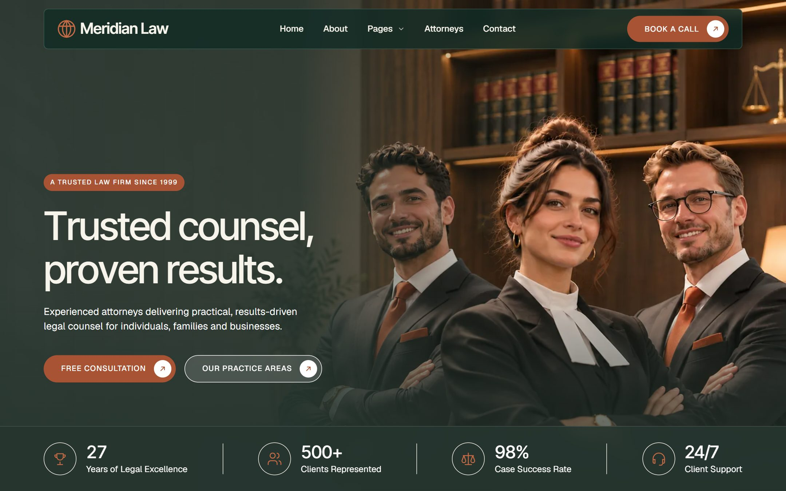

# Meridian Law - Frontend

<p align="center">
  
</p>

<p align="center"><strong>Trusted counsel, proven results.</strong> A modern, animated law-firm website built with Next.js.</p>

A responsive, multi-page law-firm website built with Next.js, React and GSAP, with separate desktop, tablet and phone (375px) layouts and scroll animations that respect `prefers-reduced-motion`. Homepage content lives in `lib/data.ts` and inner-page content in `lib/content/`; the brand name and logo in `components/Logo.tsx`.

> The project details below are real. The content on the site itself (attorneys, testimonials, case results, statistics, contact details) is sample content, and photos/video load from a remote CDN. Replace both before going live.

## Tech Stack

| Technology | Version            | Technology  | Version   |
| ---------- | ------------------ | ----------- | --------- |
| Next.js    | `^15.5.29`         | GSAP        | `3.13`    |
| React      | `^19.3.1`          | TypeScript  | `^5.9.3`  |
| Node.js    | `18.18` or later   | CSS         | Plain CSS |

## Setup

```bash
git clone https://github.com/MirnaBahaa/Meridian-Law.git
cd Meridian-Law
npm ci
npm run dev       # http://localhost:3000
npm run build     # production build
npm run start     # serve the build
```

No environment variables are required.

### Live site (GitHub Pages)

The site is published at **https://mirnabahaa.github.io/Meridian-Law/**. Every push to `main` runs `.github/workflows/deploy-pages.yml`, which builds a static copy (`npm run build:pages` → `out/`, with the `/Meridian-Law` base path) and deploys it. Internal links go through `withBase()` in `lib/base.ts`, so they work both locally and on Pages. In the repository settings, **Pages → Source** must be set to **GitHub Actions**.

## Structure

- `app/`: shared layout (navbar, footer, animations), home page, inner-page routes (`about`, `contact`, `practice-areas`, `practice-area/[slug]`, `attorneys`, `attorney/[slug]`, `case-results`, `case-study/[slug]`, `insights`, `insight/[slug]`, `not-found`), favicon, and styles (`styles.css` full design system, `site.css` additions and phone layout)
- `components/sections/`: one file per homepage section; `components/pages/`: inner-page components
- `components/`: navbar, motion layer (`Motion.tsx`), sliders, testimonial wheel, FAQ, buttons, icons, logo
- `lib/data.ts`: homepage content; `lib/content/`: inner-page content (company, practice, attorneys, cases, insights)

## Homepage Sections

1. **Hero:** "Trusted counsel, proven results." with stats: 27 years, 500+ clients, 98% success, 24/7 support
2. **About:** "Built around your outcome." with video, "Why clients stay" card and client review
3. **Practice Areas:** Personal Injury, Family, Criminal Defense, Business, Estate Planning, Employment
4. **How We Work:** Free consultation → Investigation → Negotiation → Trial if needed
5. **Testimonials:** "Five clients, five verdicts." rotating wheel
6. **Why Meridian Law:** Partner-led, Clear fees, Trial-ready, 24-hour replies
7. **Case Results:** $480M+ recovered, 1,200+ cases closed; four featured cases
8. **Attorneys:** six attorney cards
9. **Insights:** four legal guides
10. **FAQ:** six questions with a contact card
11. **Call to Action:** "Not sure where to start?"
12. **Footer:** links, contact details, gallery, copyright

## Project Details

| Field            | Value                                                                                   |
| ---------------- | --------------------------------------------------------------------------------------- |
| Project          | Meridian Law - law-firm website (frontend)                                              |
| Owner / Designer | Mirna                                                                                   |
| Repository       | [github.com/MirnaBahaa/Meridian-Law](https://github.com/MirnaBahaa/Meridian-Law)        |
| Type             | Marketing website for a New York law firm                                               |
| Scope            | Homepage (12 sections: navbar, hero, about, practice areas, how we work, testimonials, why us, case results, attorneys, insights, FAQ, call to action, footer) |
| Layouts          | Desktop (≥992px), tablet (768–991px), phone landscape (480–767px), phone (≤479px, designed at 375px) |
| Brand            | Meridian Law: original globe-and-meridian logo; forest green `#123B32`, terracotta `#A95335` / `#C56A45`, white smoke `#F7F4EC` |
| Typography       | Inter Tight (headings), Geist (body)                                                    |
| Accessibility    | Keyboard-reachable menus and controls, ARIA labels, alt text, reduced-motion support    |
| Started          | November 2026                                                                           |

### Remaining work

- Replace the sample site content (attorneys, testimonials, case results, statistics, contact details) with the firm's real information.
- Replace the CDN-hosted photos and video with licensed media stored in the project.
- Build the pages the navigation already links to: About, Practice Areas, Attorneys, Case Results, Insights, Contact, Privacy Policy, Legal Notice, and the individual practice/case/attorney/insight pages.

## Project Status

| Field              | Value                       |
| ------------------ | --------------------------- |
| Designer           | Mirna                       |
| Tool               | Claude Code                 |
